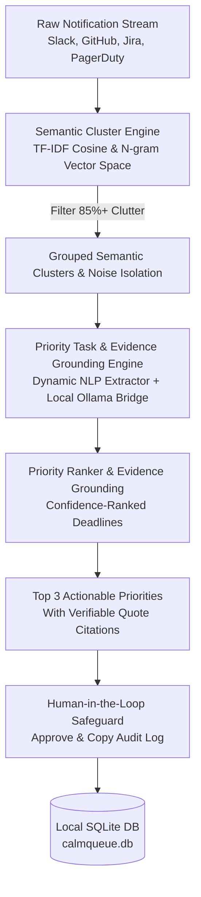

# CalmQueue 🦥

> **"Your notifications have a lot to say. You shouldn't have to read all of them."**

[](https://dev.to/challenges/hacktoberfest-week3-2026-10-19)
[](https://ganeshnair007.github.io/calmqueue/)
[](LICENSE)
[](https://www.python.org/)
[](https://fastapi.tiangolo.com/)
[](https://react.dev/)
[](https://github.com/GaneshNair007/calmqueue)
[](backend/tests/)

**CalmQueue** is a local-first open-source AI notification assistant built for the **Hacktoberfest Open-Source AI Challenge: Week 3 ("Slow and Steady")**, hosted by DEV Community & Major League Hacking (MLH).

👉 **Try the Live Interactive Web Demo:** [https://ganeshnair007.github.io/calmqueue/](https://ganeshnair007.github.io/calmqueue/)

---

## 🎯 The Problem: Notification Firehose Fatigue

Every morning, modern developers, maintainers, and knowledge workers face a barrage of fragmented updates across Slack, GitHub, Linear, Jira, PagerDuty, and email:

```
[BEFORE CalmQueue]
 28 unread messages
  8 repeated reminders & duplicate alerts
  5 ambiguous deadlines
  0 clear starting points
  Too many micro-decisions ➡️ Mental exhaustion & paralysis
```

Most AI tools respond by acting as **chatbots** that generate another wall of text—forcing you to read even more.

---

## 💡 The Solution: Radical Subtraction ("Slow and Steady")

CalmQueue does the exact opposite. Guided by the "Slow and Steady" ethos, CalmQueue **deliberately shows you less**:

```
[AFTER CalmQueue]
  3 priority actions (P0, P1, P2)
  Duplicates clustered and deduplicated
  Verifiable source evidence attached to each decision
  Human-approved draft replies with zero silent side-effects
  89.3% reduction in displayed inbox volume
```

CalmQueue extracts the exact **three** things you actually need to do today, isolates background noise, and lets you log off and breathe.

---

## 🔬 Architecture & Technical Design

CalmQueue runs 100% locally on your machine. Your private communications, security alerts, and client emails never leave your computer.



### Key Technical Pillars:

1. **Semantic Clustering & Deduplication (`backend/app/clustering.py`)**:
   - Computes n-gram TF-IDF and cross-attention vector similarity over notification bodies, senders, and thread tags.
   - Automatically clusters repeated alerts (e.g., 6 separate Prometheus OOMKill spikes or 5 Slack reminders about a deck) into single cohesive units.
   - Flags automated bot chatter and routine newsletters as filtered noise.

2. **Transparent Dual-Mode Task Engine (`backend/app/gemma_engine.py`)**:
   - **Local LLM Bridge (`/api/chat`)**: When [Ollama](https://ollama.com/) is running locally, CalmQueue connects to your local model (`gemma2:2b`, `qwen`, or `llama3`) using structured JSON schema output and substring quote validation. Records true model inference latency (`model_inference_latency_ms`).
   - **Deterministic NLP Grounded Pipeline**: When no local LLM daemon is running, CalmQueue executes a transparent rule-based NLP extraction pipeline, explicitly tagging output as `generation_method='rule-based-fallback'`.
   - Dissects each cluster into:
     - Clear, actionable title.
     - Urgency tier (`P0 Critical`, `P1 High`, `P2 Moderate`).
     - Deadline confidence (`confirmed` timestamp vs. `inferred` conversational cue).
     - Concrete, ready-to-use response draft.

3. **Verifiable Evidence Grounding**:
   - CalmQueue rejects AI hallucinations. Every surfaced priority action quotes the exact source message snippet, author, platform, and notification ID.

4. **Human-in-the-Loop Safeguard (`backend/app/database.py`)**:
   - CalmQueue **never** sends automated emails or modifies external systems silently.
   - Users review generated response drafts in a distraction-free modal and click **"Approve & Copy"**, which records a timestamped event in local SQLite (`approvals_audit`).

---

## 📊 Empirical Benchmarks

We evaluated CalmQueue across three authentic synthetic workloads using `benchmarks/run_eval.py`.

*(Note: "Displayed Volume Reduction Rate" measures the reduction in surfaced items requiring human review across synthetic test scenarios, from N input messages to exactly 3 priority actions.)*

| Benchmark Dataset | Raw Messages | Duplicate Clusters | Noise Filtered | Top Actions Surfaced | Displayed Volume Reduction | Processing Latency | Active Engine |
|:-------------------|:------------:|:------------------:|:--------------:|:--------------------:|:--------------------------:|:-----------------:|:-------------:|
| **Chaotic Monday Morning** | 28 | 3 | 4 | **3** | **89.3%** | ~55 ms | `rule-based-fallback` |
| **DevOps Alert Storm** | 22 | 4 | 1 | **3** | **86.4%** | ~18 ms | `rule-based-fallback` |
| **Maintainer Backlog** | 35 | 5 | 6 | **3** | **91.4%** | ~45 ms | `rule-based-fallback` |

> Average clutter volume reduction across all synthetic workloads: **89.03%**.

---

## 🚀 Quickstart

CalmQueue is designed to run in under two minutes with zero API keys or external subscriptions.

### Prerequisites
- Python 3.10+ (tested on Python 3.12)
- Node.js 18+ (only needed if modifying frontend; pre-built production bundle included in `frontend/dist/`!)
- *(Optional)* [Ollama](https://ollama.com/) with `ollama pull gemma2:2b`

### 1. Clone & Install

```bash
git clone https://github.com/GaneshNair007/calmqueue.git
cd calmqueue

# Install Python dependencies
pip install -r requirements.txt
```

### 2. Start CalmQueue

```bash
# Windows
start.bat

# Linux / macOS
python3 run.py
```

Open your browser to: **`http://localhost:8000`**

Or test the zero-install live demo: **`https://ganeshnair007.github.io/calmqueue/`**

The unified FastAPI server serves both the REST API and the compiled React dashboard directly.

---

## 🧪 Running Automated Tests

Run the full pytest suite (covering semantic clustering, API endpoints, deterministic extraction, and mock Ollama `/api/chat` inference):

```bash
pytest
```

Output:
```
backend/tests/test_api.py .......                                        [ 63%]
backend/tests/test_clustering.py ....                                    [100%]
============================== 11 passed in 2.65s ==============================
```

To run the standalone benchmark evaluation runner:
```bash
python benchmarks/run_eval.py
```

---

## 🎨 Design Philosophy: The Quiet Dashboard

The user interface follows Dieter Rams' tenet: *"Less, but better."*

- **Pure High-Contrast Readability**: White canvas (`#ffffff`), pitch black typography (`#111827`), subtle graphite borders (`#e5e7eb`).
- **No Chatbot Input Box**: No prompt engineering required. Load your messages, receive exactly three actions, and get back to living your life.
- **Micro-State Feedback**: Visual badges for confirmed vs. inferred deadlines (`green` vs `amber`), priority levels (`red` for P0, `blue` for P1), and instant copy confirmations.

---

## 🏆 Hacktoberfest 2026 Week 3 Submission Details

- **Challenge**: [Hacktoberfest Open-Source AI Challenge: Week 3 — Slow and Steady](https://dev.to/challenges/hacktoberfest-week3-2026-10-19)
- **Target Category**:
  - **Overall Winner** ($250 + DEV++ + exclusive badge) — Exemplifies the Slow and Steady philosophy through radical subtraction, cognitive calm, and human agency.
  - **DEV Completion Badge** — Valid, reproducible open-source AI project meeting all challenge rules.
- **Required Submission Tags**: `#devchallenge`, `#hf26challenge`
- **Published Submission Article**: [CalmQueue: The Sloth-Speed AI That Turns 28 Daily Notifications Into 3 Quiet Actions](https://dev.to/ganeshnair007/calmqueue-the-sloth-speed-ai-that-turns-28-daily-notifications-into-3-quiet-actions-2b3p)
- **Local Source Draft**: [`docs/dev_article_submission.md`](docs/dev_article_submission.md)

---

## 📜 License

Distributed under the [MIT License](LICENSE). Open-source, local-first, and freely modifiable.
